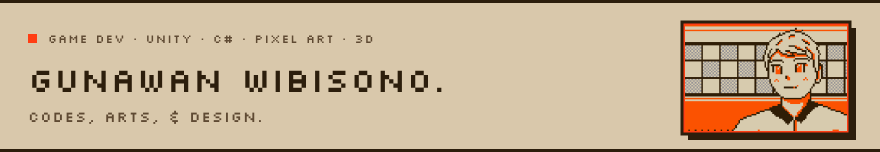
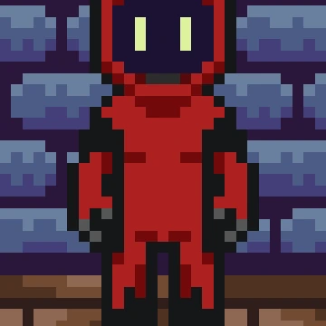
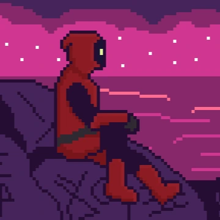
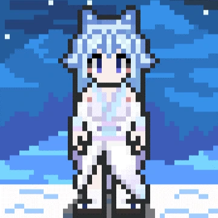
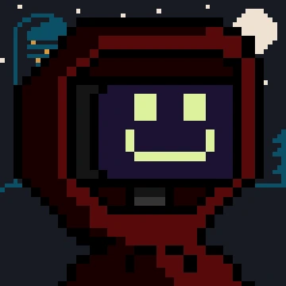
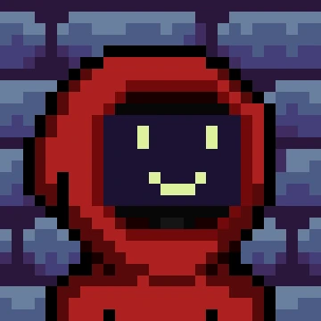
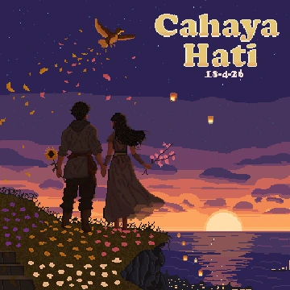

  

  
  
  
  
  

---

### 🎮 About me

Game developer based in Malang, Indonesia. I build games in Unity — the pixel art, the level
design, and the code that holds it together.

- 🎯 Currently **Project Manager, Level Designer and 2D Pixel Artist** at Ariverse Studio
- 🎓 Studying **Applied Informatics Engineering** at Polinema
- 🕹️ Shipping small games end to end: [Mechquarium](https://horoboy.my.id/projects/mechquarium/), [Minimate](https://horoboy.my.id/projects/minimate/), [Barongsway](https://horoboy.my.id/projects/barongsway/)
- 🌱 Learning whatever the next project needs

---

### 🛠 Tech stack

  
  
  
  
  
  
  
  

---

### 🕹 Projects

| Project | Year | Status | What it is |
| :--- | :---: | :--- | :--- |
| **[Mechquarium](https://horoboy.my.id/projects/mechquarium/)** | 2026 | `wip` | Recreating Insaniquarium from scratch |
| **[Minimate](https://horoboy.my.id/projects/minimate/)** | 2025 | `wip` | Chess puzzle game with a unique twist and turn |
| **[Barongsway](https://horoboy.my.id/projects/barongsway/)** | 2026 | `complete` | Multiplayer platformer for two players on one screen |
| **[Triblock Dash](https://horoboy.my.id/projects/triblock-dash/)** | 2025 | `complete` | Fast-paced three-lane arcade runner |
| **[Magicaffeine](https://horoboy.my.id/projects/magicaffeine/)** | 2025 | `complete` | Cozy game about serving coffee |

All built in Unity with C#, art in Aseprite. More at [horoboy.my.id/projects](https://horoboy.my.id/#projects).

---

### 🎨 Pixel art

  
  
  
  
  
  

  Horoboy 32 · Horoboy in Void · Kanachan · Pixel Pp · Robo Ghost Smile · DND Cahaya Hati — <a href="https://horoboy.my.id/pixels/">full gallery</a>

---

### 💼 Experience

**Ariverse Studio** — 3 roles

| Role | Period | What I do |
| :--- | :---: | :--- |
| **Project Manager** | 2026 — Now | Managing game projects so they hit the quality bar, and keeping the team in shape to finish every task the studio hands over |
| **Level Designer** | 2026 — Now | Blockouts, pacing and encounter design — building and tuning levels in Unity from first sketch to ship, driven by playtests |
| **2D Pixel Artist** | 2025 — Now | Creating pixel assets and implementing them ready-to-use in the studio production pipeline |

**Polinema** — Bachelor of Applied Informatics Engineering · 2024 — Now

Building a practical foundation in software development while specializing through independent
and collaborative game projects — programming fundamentals, Unity, interface design and pixel art.

---

### 📊 GitHub

  
  
  
  

Most of my work lives in class and private repositories, so the contribution graph says more than
the public repo count.

---

### 📫 Contact

  
  
  
  
  

  

