<!-- Generated by scripts/build_readme.py — edit that file, not this one. -->

<a href="https://horoboy.my.id">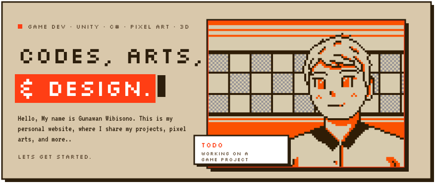</a>

<a href="https://horoboy.my.id/#about">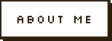</a>

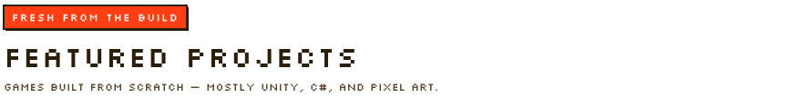

<a href="https://horoboy.my.id/projects/mechquarium/">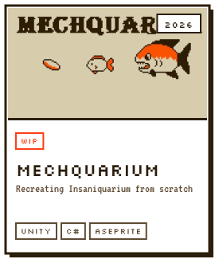</a>
<a href="https://horoboy.my.id/projects/minimate/">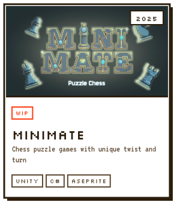</a>
<a href="https://horoboy.my.id/projects/barongsway/">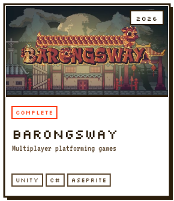</a>
<a href="https://horoboy.my.id/projects/triblock-dash/">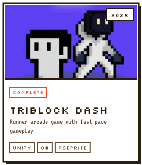</a>
<a href="https://horoboy.my.id/projects/magicaffeine/">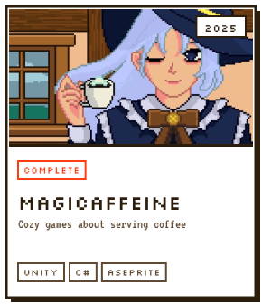</a>

<a href="https://horoboy.my.id/#projects">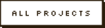</a>

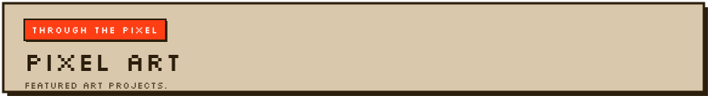

<a href="https://horoboy.my.id/pixels/">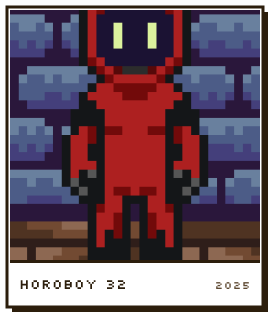</a>
<a href="https://horoboy.my.id/pixels/">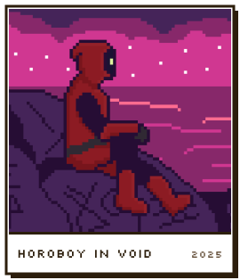</a>
<a href="https://horoboy.my.id/pixels/">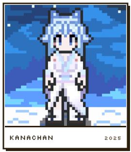</a>
<a href="https://horoboy.my.id/pixels/">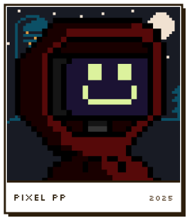</a>
<a href="https://horoboy.my.id/pixels/">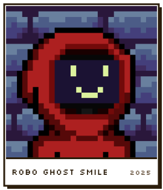</a>
<a href="https://horoboy.my.id/pixels/">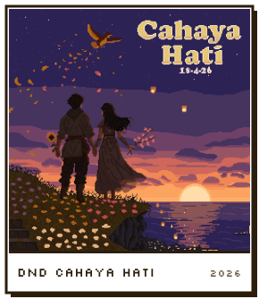</a>

<a href="https://horoboy.my.id/pixels/">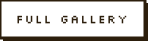</a>

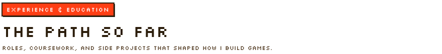

**Ariverse Studio** — 3 roles

| Role | Period | What I do |
| --- | --- | --- |
| **Project Manager** | 2026 — Now | Managing game development projects so they hit the quality bar, and keeping the team in shape to finish every task the studio hands over. |
| **Level Designer** | 2026 — Now | Blockouts, pacing and encounter design. Builds and tunes levels in Unity from first sketch to ship, driven by playtests and clear design docs. |
| **2D Pixel Artist** | 2025 — Now | Creating pixel assets for game projects and implementing them ready-to-use in the studio production pipeline. |

**Polinema** — Bachelor of Applied Informatics Engineering · 2024 — Now

Building a practical foundation in software development while specializing through independent
and collaborative game projects. Coursework and production work connect programming fundamentals
with Unity development, interface design and pixel art.

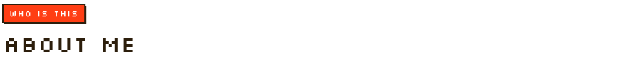

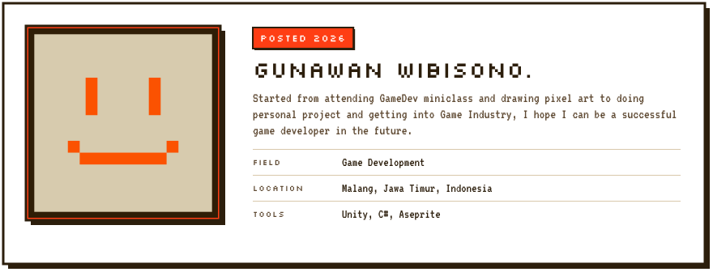

<a href="https://github.com/HooroBoy" target="_blank">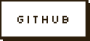</a>
<a href="https://horoboy.itch.io/" target="_blank">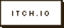</a>

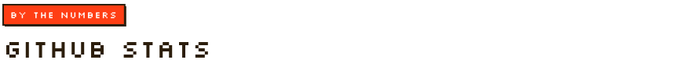

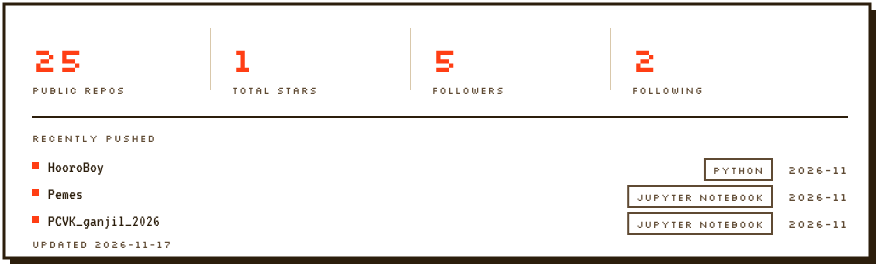

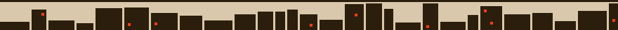
